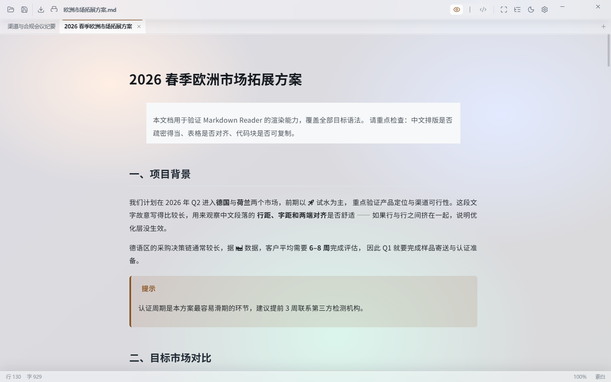
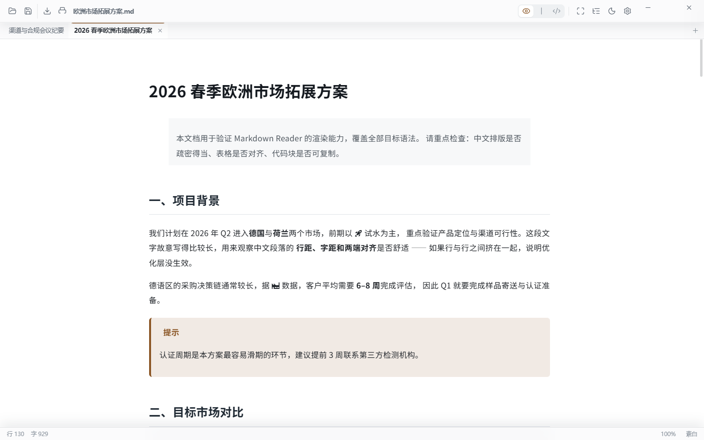
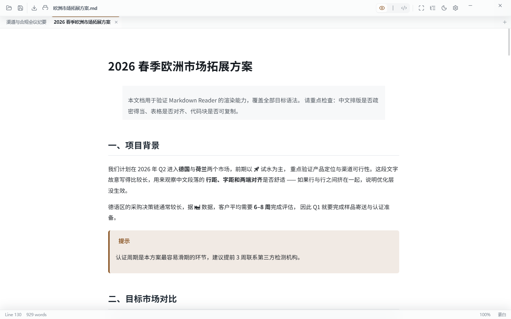

<div align="center">

# Eunice Reader

**A Windows-native Markdown reader built for Chinese typography** — reading first, light editing second.

Tauri 2 + WebView2 · Fully offline · Complete CJK fonts bundled · Tabs & split panes · Zen mode · MIT

[中文](README.md) · [English](README.en.md) · [Features](#features) · [Screenshots](#screenshots) · [Install](#install) · [Shortcuts](#shortcuts) · [Tech stack](#tech-stack) · [Design notes](docs/DESIGN.md) · [Development](#development)

</div>

---

## Why a *reader*

Most Markdown tools assume you are about to **write** something: you open a file and get a wall of
toolbars, syntax highlighting and a blinking cursor. This project assumes the opposite —
**you opened a document because you want to read it through.**

- It starts in **reading view**; CodeMirror (575 KB) is never loaded until you press `Ctrl+3`.
- Typography is tuned for long-form CJK text: 1.9 line height, 900 px measure, justified Chinese
  paragraphs, punctuation compression, spacing between Latin and CJK.
- Complete CJK fonts are bundled, so **no glyph ever falls back** to a system font and changes shape.
- The first screen only loads what "opening the app" needs. Syntax highlighting, math and diagrams
  are loaded on demand.

It is a personal, single-purpose tool, so it does not compromise on size: about 59 MB installed,
most of which is fonts.

## Features

### Reading

- **Full GFM** plus table alignment, task lists, strikethrough, footnotes, emoji shortcodes (`:rocket:`)
- **Math** (KaTeX, `$…$` / `$$…$$`), **diagrams** (Mermaid, ten kinds), **syntax highlighting**
  (highlight.js, 180+ languages)
- **Admonitions**: `:::note / tip / important / warning / caution`
- **Outline sidebar** — one tree walk collects headings and enhances the DOM; the current section is
  highlighted while you scroll (`Ctrl+B`)
- **CJK typography layer** — justification, punctuation compression, inline-code and Latin spacing,
  tabular numerals in tables
- **Long documents** — above ~120k characters, off-screen blocks are skipped for layout and paint

### Tabs and split panes

- **Tabs** — opening a file creates a new tab and switches to it; a file already open in that pane is
  focused instead. Tab titles come from the document **H1**, falling back to the first 16 characters
- **Split panes** — drop a file on the **left or right quarter** of the window to open it in a pane on
  that side; drop it in the **middle** to open a tab. While dragging, the window splits into three
  highlighted zones, so the result is decided *before* you release the mouse
- Every pane keeps its own tab list, view mode and editor instance; a pane closes itself when its last
  tab is closed
- **Tab layout** — a strip under the toolbar, or a column on the left

### Display

- **Global zoom** — `Ctrl+=` / `Ctrl+-` / `Ctrl+0` or `Ctrl+wheel`, with the percentage in the status
  bar (50%–300%). Font size, measure, padding and editor size all derive from **one coefficient**, so
  the number of characters per line stays the same
- **12 document themes** — each one drives paper, body, headings, quotes, tables, code backgrounds and
  syntax hues together; thumbnail cards render real samples in a Shadow DOM, with category tabs and
  starring
- **11 font presets** — Noto Sans/Serif SC, LXGW WenKai, LXGW Neo ZhiSong, Swei Gothic, Sarasa Mono SC,
  Glow Sans, plus Latin pairings with Inter / EB Garamond / JetBrains Mono
- **Full-window glass** (on by default) — the window itself is transparent and Windows *acrylic* blurs
  whatever is behind it; the interface paints itself translucent so that blur shows through. You can
  faintly see the colour blocks of the windows below while text stays sharp. One switch turns it opaque
- **Frameless window** — the OS title bar is gone; minimise / maximise / close and eight resize edges
  are drawn in the app's own style. Double-clicking the top bar maximises or restores
- **Zen mode** (`Ctrl+Shift+Z`) — content only. The chrome slides back in when the pointer reaches the
  top, left or bottom edge. If the window was maximised, it goes **true fullscreen**
- **Bilingual UI** — follows the system language by default (WebView2's `navigator.language` *is* the
  Windows display language), or locked to 简体中文 / English in Settings. Theme names, font names,
  panel text and dialogs are all translated

### Editing and export

- **CodeMirror 6** editing (loaded on demand), with reading / split / edit views
- Autosave, Save As, and an unsaved-changes dot on the tab
- **PDF export** through WebView2's native `PrintToPdf`: same engine, same HTML/CSS as the screen, so
  the layout matches exactly and the text stays selectable and searchable. No PDF library involved

### Windows integration

- **File association** for 9 extensions (`.md .markdown .mdown .mkd .mdwn .mdtxt .mdtext .rmd .qmd`)
- **Context menu** entry "Open with Eunice Reader", cleaned up on uninstall, with Explorer notified
- A **dedicated document icon** for `.md` (not the app icon)
- **Single instance** — opening another file focuses the running window and hands the document over
- **Encoding fallback** — UTF-8 first (BOM aware) → GB18030 → GBK → Big5, with the source shown in the
  status bar
- **Drag and drop** — middle of the window opens a tab, the outer quarters open a split pane

### Performance (all guarded by scripts)

| Invariant | Measured | Guard |
|---|---|---|
| First screen carries no on-demand library | 267 KB entry (600 KB budget) | `python scripts/check-build-perf.py` |
| Fonts are sliced by `unicode-range` | first document 8.12 MB → 0.55 MB | `python scripts/slice-fonts.py` |
| Parsing and rendering agree | 34 syntax assertions | `node scripts/smoke-test.mjs` |

On-demand chunks: mermaid ≈5 MB (a diagram appears), CodeMirror 565 KB (edit/split view),
KaTeX 253 KB + 29 KB CSS (a `$` appears), highlight.js 154 KB (code blocks, warmed while idle).

## Screenshots

| Reading with tabs (custom window controls) | Split panes |
|---|---|
|  |  |

| Left tab layout | Zen mode |
|---|---|
|  |  |

| Full-window glass (on) | Full-window glass (off) |
|---|---|
|  |  |

English UI (follows the system language, or set it manually):



Settings drawer:


## Install

1. Download the installer from [Releases](https://github.com/greatcxc/eunice-reader/releases/latest)
   (`Eunice.Reader_x.y.z_x64-setup.exe`, about 59 MB)
2. Run it. It installs per user (`currentUser`), so **no administrator rights** are needed
3. Afterwards `.md` files get their own document icon and context menu entry, and the app shows up in
   "Open with"

**Requirements**: Windows 10 1809+ or Windows 11, x64. WebView2 is required at runtime — it ships with
Windows 11 and is already present on most Windows 10 machines via Edge; if it is missing, the installer
offers to download it.

The window is **frameless** (no OS title bar): the top bar *is* the title bar — drag it, double-click to
maximise/restore, and use the minimise / maximise / close buttons on its right. All four edges and
corners resize the window. Full-window glass relies on Windows *acrylic*, which needs Windows 11 or
Windows 10 1803+; on older builds it degrades to "translucent without blur" and can be switched off in
Settings.

**Two prompts you may see — neither is a bug:**

- **SmartScreen** may block the installer because it is not code-signed (this is a personal project and
  certificates cost money). Choose "More info → Run anyway".
- **`.md` may not automatically open with Eunice Reader.** Since Windows 8 the default app is decided
  by `UserChoice`, which is hash-protected, so **no installer can change it** — that is a system design
  decision, not an omission. Open the app → Settings → **File association** → "Set as default app",
  which takes you to the Windows Default apps page to confirm once.

## Shortcuts

| Shortcut | Action |
|---|---|
| `Ctrl+O` / `Ctrl+S` / `Ctrl+Shift+S` | Open (new tab) / Save / Save as |
| `Ctrl+Shift+E` | Export PDF |
| `Ctrl+=` / `Ctrl+-` / `Ctrl+0` | Zoom in / out / reset to 100% |
| `Ctrl+wheel` | Continuous zoom |
| `Ctrl+Shift+Z` / `Esc` | Enter / leave Zen mode |
| `Ctrl+1` / `Ctrl+2` / `Ctrl+3` | Reading / split (source + preview) / edit |
| `Ctrl+B` | Outline sidebar |
| `Ctrl+Shift+D` | Toggle light / dark UI |
| `Ctrl+,` | Settings drawer |
| `Ctrl+F` | Search |

Close a tab with the middle mouse button or its `×`. (`Ctrl+W` is deliberately **not** bound:
WebView2 may treat it as the system "close window" accelerator, and losing unsaved work to a
mis-fire is not a fair trade.)

## Tech stack

Every parsing capability comes from a mature open-source project; no Markdown syntax is reimplemented.

| Layer | Project | License | Layer | Project | License |
|---|---|---|---|---|---|
| Desktop shell | Tauri 2 | MIT / Apache-2.0 | HTML sanitising | DOMPurify | MPL-2.0 / Apache-2.0 |
| Markdown | markdown-it | MIT | Editor | CodeMirror 6 | MIT |
| Task lists | markdown-it-task-lists | ISC | UI icons | Lucide | ISC |
| Footnotes | markdown-it-footnote | MIT | CJK fonts | Noto Sans/Serif SC | OFL |
| Emoji | markdown-it-emoji | MIT | Kai script | LXGW WenKai | OFL |
| Heading anchors | markdown-it-anchor | MIT | Rounded / ZhiSong | Swei Gothic / LXGW Neo ZhiSong | OFL |
| Admonitions | markdown-it-container | MIT | Latin fonts | Inter / EB Garamond / JetBrains Mono | OFL |
| Math | @vscode/markdown-it-katex + KaTeX | MIT | GBK decoding | encoding_rs | MIT / Apache-2.0 |
| Diagrams | mermaid | MIT | Syntax highlighting | highlight.js | BSD-3-Clause |

Full licence texts and provenance are listed in [docs/THIRD-PARTY.md](docs/THIRD-PARTY.md).

## Project layout

```
src/
  main.js            Entry: panes / tabs / drag & drop / Zen / zoom / shortcuts / file actions
  lib/               Settings persistence, document themes, font presets, i18n
  markdown/          markdown-it pipeline (index), DOM enhancement (enhance), sanitising (sanitize)
  editor/            CodeMirror 6 (loaded on demand)
  ui/                Settings drawer, icons
  styles/            app / theme / zh-optimize / print
  fonts/             Bundled fonts and unicode-range slices
  icons/             UI icons (Lucide, inlined at build time)
src-tauri/
  src/lib.rs         File I/O, window, PDF export, file associations
  installer-hooks.nsh  NSIS hook: context menu, Open-with, document icon
  tauri.conf.json    Bundling and file association declarations
samples/             Sample documents used to verify rendering
scripts/             Build checks, font slicing, headless QA harnesses
docs/                Design notes, third-party licences, QA records
```

## Development

```bash
npm install
npm run tauri:dev     # development
npm run tauri:build   # build the NSIS installer
```

Build checks:

```bash
node scripts/smoke-test.mjs         # 34 Markdown rendering assertions
python scripts/check-build-perf.py  # first-screen size, on-demand chunks, asset references
python scripts/check-coverage.py    # measured font character coverage
python scripts/slice-fonts.py       # regenerate font slices (asserts cmap union equality)
```

UI changes are verified in a **headless browser**, without ever opening an app window —
`scripts/qa/` contains three harnesses (settings panel, reading-area zoom, and the whole shell with
tabs / split panes / Zen). They `import` the real `src/*`, so what you see is what the app renders.
See [scripts/qa/README.md](scripts/qa/README.md).

> The committed `.npmrc` only sets the registry and retry settings — no proxy. If your network needs
> one, add it locally rather than committing it.

## License

[MIT](LICENSE) © 2026 greatcxc

Use it, modify it, redistribute it, **use it commercially** — the only requirement is to keep the
copyright notice and licence text (i.e. credit the original author). Bundled fonts and third-party
libraries keep their own licences (mostly OFL / MIT / ISC / BSD); see
[docs/THIRD-PARTY.md](docs/THIRD-PARTY.md).

Change history: [CHANGELOG.md](CHANGELOG.md) (Chinese).
