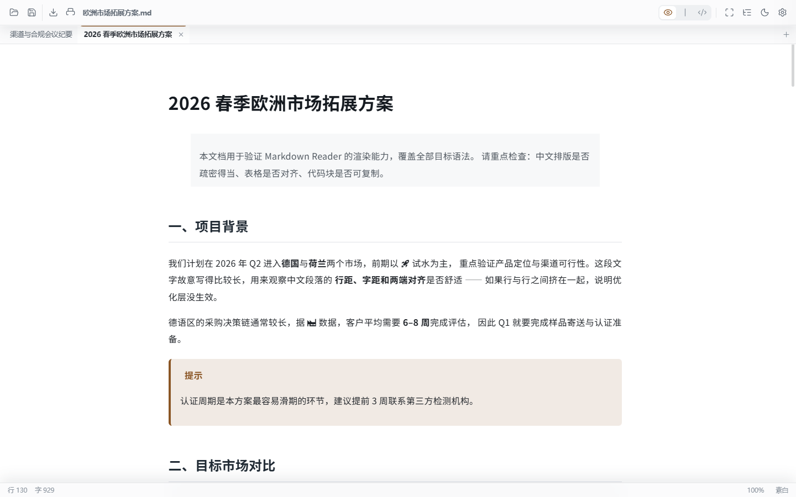
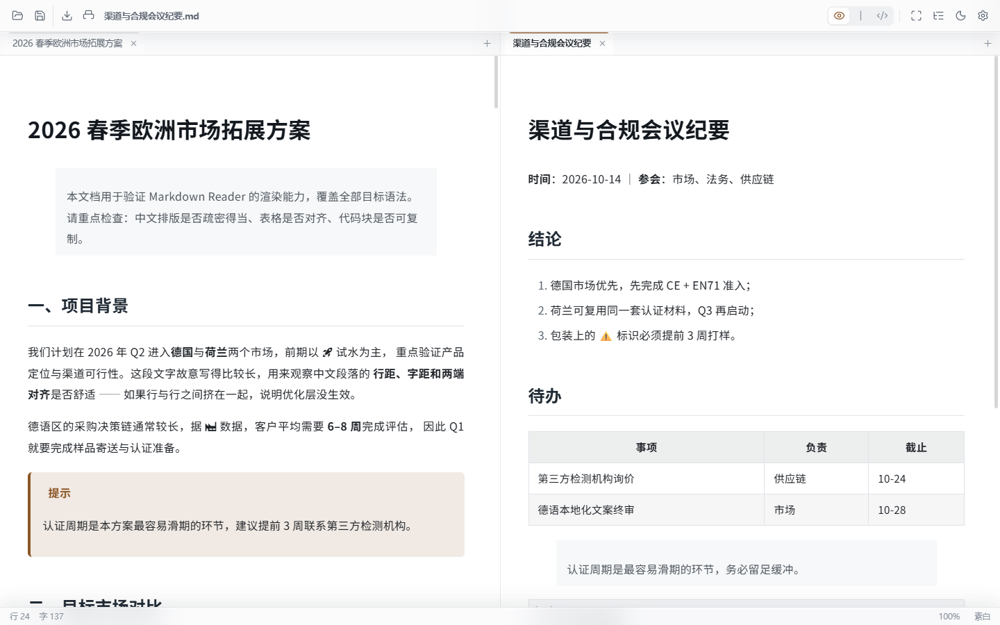
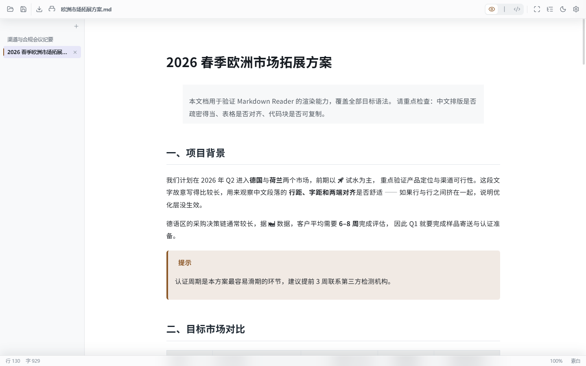

<div align="center">

# Eunice Reader

**面向 Windows 的中文 Markdown 阅读器** —— 以「读」为主，「改」为辅。

Tauri 2 + WebView2 · 完全离线 · 内置完整 CJK 字体 · 标签与分栏 · Zen 模式 · MIT

[功能](#功能) · [截图](#截图) · [安装](#安装) · [快捷键](#快捷键) · [技术栈](#技术栈) · [设计取舍](docs/DESIGN.md) · [开发](#开发)

</div>

---

> **English TL;DR** — Eunice Reader is a Windows-native **Markdown reader** (with light editing) built on Tauri 2 + WebView2.
> It renders full GFM plus footnotes, emoji, KaTeX and Mermaid; ships **complete CJK fonts** so no glyph ever falls
> back to a system font; and is tuned for Chinese long-form reading (measure, line height, punctuation, justification).
> Tabs, split panes, a chrome-free **Zen mode**, 12 document themes, 11 font presets, PDF export and Windows file
> associations are built in. Free for commercial use under the **MIT** license.

## 为什么是「阅读器」

大多数 Markdown 工具的默认假设是「你要写点什么」，于是打开一个文件先看到一屏工具栏、语法高亮和光标。
这个项目的假设相反：**打开一份文档，就是要把这份文档读完**。

- 默认进入**阅读视图**，编辑器完全不加载（`Ctrl+3` 或点工具栏才切过去）；
- 排版按中文长文调：行高 1.9、行宽 900px、中文两端对齐、标点挤压；
- 内置完整字符集的中文字体，**任何汉字都不会掉进系统回退**导致字形突变；
- 首屏只做「打开软件」这件事本身，代码高亮、公式、图表全部按需加载。

定位是「个人自用的中文长文阅读器」，所以它不为体积做妥协 —— 装完约 59 MB，其中大部分是字体。

## 功能

### 阅读体验

- **完整 GFM** + 表格对齐、任务列表、删除线、脚注、Emoji 短码（`:rocket:`）
- **数学公式**（KaTeX，`$…$` / `$$…$$`）、**图表**（Mermaid 十种图）、**代码高亮**（highlight.js，180+ 语言）
- **提示块**：`:::note / tip / important / warning / caution`
- **大纲侧栏**：一次树遍历同时完成界面增强与标题收集，滚动时高亮当前章节（`Ctrl+B`）
- **中文排版优化层**：两端对齐、标点挤压、行内代码与西文间距、表格数字等宽
- **长文档优化**：正文超过 12 万字自动启用 `content-visibility`，屏外块跳过布局与绘制

### 标签与分栏

- **标签页**：打开文件默认在新标签里打开并切过去；标签名取文档 **H1**，没有 H1 取正文前 16 字
- **分栏**：把文件拖到窗口**左 / 右 1/4** 就在对应一侧开一栏，拖到**中间**开新标签 ——
  拖动时窗口分成三档并高亮鼠标所在档位，落点在松手前就是确定的
- 每栏有自己的标签列表、视图模式与编辑器实例；一栏标签关光后自动收起
- **标签布局**可选顶部（顶栏下方一条玻璃）或左侧（正文左边一列）

### 显示

- **整体缩放**：`Ctrl+=` / `Ctrl+-` / `Ctrl+0` 或 `Ctrl+滚轮`，状态栏实时显示百分比（50%–300%）。
  字号、行宽、留白、编辑区字号全部由**同一个系数**乘出来，每行字数保持不变
- **12 款正文主题**：一套主题联动纸面、正文、标题、引用、表格、代码块底色与语法着色色相；
  卡片用 Shadow DOM 真实渲染中文缩略图，分类页签 + 星标收藏
- **11 套字体预设**：思源黑体/宋体、霞鹜文楷、霞鹜新致宋、狮尾圆体、更纱等宽、未来荧黑，
  以及 Inter / EB Garamond / JetBrains Mono 的西文混排组合
- **毛玻璃**：顶栏、标签条、状态栏、侧栏、设置抽屉都是 `backdrop-filter` 浮层，正文从它们下面滚过去
- **Zen 模式**（`Ctrl+Shift+Z`）：只剩正文；鼠标靠近窗口上/左/下缘时界面才滑出来。
  窗口原本最大化时直接切**真全屏**，并隐藏系统标题栏

### 编辑与导出

- **CodeMirror 6** 轻量编辑（575 KB 按需加载），阅读 / 分栏 / 编辑三视图切换
- 自动保存、另存为、未保存标记圆点
- **导出 PDF**：走 WebView2 原生 `PrintToPdf`，与屏幕同一套 HTML/CSS ——
  排版完全一致，文字可选中可搜索，不引入任何 PDF 渲染库

### Windows 集成

- **文件关联**：9 种扩展名（`.md .markdown .mdown .mkd .mdwn .mdtxt .mdtext .rmd .qmd`）
- **右键菜单**「使用 Eunice Reader 打开」，卸载时清理并通知资源管理器刷新
- **`.md` 专属文档图标**（不是 app 图标）
- **单实例**：已经开着时再双击文件，切到已有窗口并把文档推给它
- **编码回退**：UTF-8 优先（检测 BOM）→ GB18030 → GBK → Big5，状态栏标出编码来源
- **拖放打开**：拖到中间开标签，拖到左右 1/4 分栏

### 性能（都有脚本守着）

| 不变式 | 实测 | 守卫 |
|---|---|---|
| 首屏 JS 不背按需库 | 入口 267 KB（预算 600 KB） | `python scripts/check-build-perf.py` |
| 字体按 `unicode-range` 分片，首屏只取用到的层 | 首开文档 8.12 MB → 0.55 MB | `python scripts/slice-fonts.py` |
| 文档解析与渲染一致 | 34 项语法断言 | `node scripts/smoke-test.mjs` |

按需加载：mermaid ≈5 MB（文档出现图表时）、CodeMirror 565 KB（切到编辑/分栏）、
KaTeX 253 KB + 29 KB CSS（文档出现 `$`）、highlight.js 154 KB（有代码块且空闲时预热）。

## 截图

| 阅读 + 标签 | 分栏 |
|---|---|
|  |  |

| 左侧标签布局 | Zen 模式 |
|---|---|
|  |  |


## 安装

1. 到 [Releases](https://github.com/greatcxc/eunice-reader/releases/latest) 下载安装包
   （`Eunice.Reader_x.y.z_x64-setup.exe`，约 59 MB）
2. 双击安装。默认 `currentUser` 模式，**不需要管理员权限**
3. 安装完 `.md` 就有了专属文档图标与右键菜单；应用会出现在「打开方式」列表里

**系统要求**：Windows 10 1809+ / Windows 11，x64。运行时依赖 WebView2 ——
Win11 自带，Win10 多数已随 Edge 安装；缺失时安装器会自动引导下载。

**两个可能遇到的提示，都不是故障：**

- **SmartScreen 拦截**：安装包未做代码签名（个人项目，证书要钱），
  点「更多信息 → 仍要运行」即可。
- **`.md` 的默认应用没自动变成 Eunice Reader**：Windows 8 起「默认应用」由 `UserChoice`
  决定，它带哈希校验，**任何安装器都改不了**（这是系统设计，不是安装包漏做）。
  打开应用 → 设置 → **文件关联** → 「设为默认打开方式」，会跳到系统设置页让你确认一次。

## 快捷键

| 快捷键 | 功能 |
|---|---|
| `Ctrl+O` / `Ctrl+S` / `Ctrl+Shift+S` | 打开（新标签）/ 保存 / 另存为 |
| `Ctrl+Shift+E` | 导出 PDF |
| `Ctrl+=` / `Ctrl+-` / `Ctrl+0` | 放大 / 缩小 / 缩放复位 100% |
| `Ctrl+滚轮` | 连续缩放 |
| `Ctrl+Shift+Z` / `Esc` | 进入 / 退出 Zen 模式 |
| `Ctrl+1` / `Ctrl+2` / `Ctrl+3` | 阅读 / 分栏（源码 + 预览）/ 编辑 |
| `Ctrl+B` | 大纲侧栏 |
| `Ctrl+Shift+D` | 明暗切换 |
| `Ctrl+,` | 设置抽屉 |
| `Ctrl+F` | 搜索 |

标签用鼠标**中键**或标签上的 `×` 关闭。（没有绑定 `Ctrl+W`：WebView2 可能把它当「关闭窗口」的
系统加速键，一旦拦不住就是未保存内容直接丢，风险不对等。）

## 技术栈

所有解析能力都用成熟开源方案，不自研任何 Markdown 语法。

| 环节 | 方案 | 许可证 | 环节 | 方案 | 许可证 |
|---|---|---|---|---|---|
| 桌面外壳 | Tauri 2 | MIT / Apache-2.0 | HTML 消毒 | DOMPurify | MPL-2.0 / Apache-2.0 |
| Markdown | markdown-it | MIT | 编辑器 | CodeMirror 6 | MIT |
| 任务列表 | markdown-it-task-lists | ISC | 界面图标 | Lucide | ISC |
| 脚注 | markdown-it-footnote | MIT | 中文字体 | 思源黑体 / 宋体 | OFL |
| Emoji | markdown-it-emoji | MIT | 楷体 | 霞鹜文楷 | OFL |
| 标题锚点 | markdown-it-anchor | MIT | 圆体 / 致宋 | 狮尾圆体 / 霞鹜新致宋 | OFL |
| 提示块 | markdown-it-container | MIT | 西文字体 | Inter / EB Garamond / JetBrains Mono | OFL |
| 数学公式 | @vscode/markdown-it-katex + KaTeX | MIT | GBK 解码 | encoding_rs | MIT / Apache-2.0 |
| 图表 | mermaid | MIT | 代码高亮 | highlight.js | BSD-3-Clause |

第三方组件的完整许可文本与出处见 [docs/THIRD-PARTY.md](docs/THIRD-PARTY.md)。

## 项目结构

```
src/
  main.js            入口：分组 / 标签 / 拖放 / Zen / 缩放 / 快捷键 / 文件操作
  lib/               设置持久化、正文主题、字体预设
  markdown/          markdown-it 管线（index）、界面增强（enhance）、消毒（sanitize）
  editor/            CodeMirror 6（按需加载）
  ui/                设置抽屉、图标
  styles/            app / theme / zh-optimize / print
  fonts/             内置字体与分片
  icons/             界面图标（Lucide，构建期内联）
src-tauri/
  src/lib.rs         文件读写、窗口、PDF 导出、文件关联
  installer-hooks.nsh  NSIS 安装钩子：右键菜单、打开方式、文件图标
  tauri.conf.json    打包与文件关联声明
samples/             用于验证渲染的样例文档
scripts/             构建校验、字体分片、无头 QA 工装
docs/                设计取舍、第三方许可、QA 记录
```

## 开发

```bash
npm install
npm run tauri:dev     # 开发模式
npm run tauri:build   # 打包 NSIS 安装包
```

构建校验：

```bash
node scripts/smoke-test.mjs         # 34 项 Markdown 语法渲染断言
python scripts/check-build-perf.py  # 首屏体积、按需库、资源引用完整性
python scripts/check-coverage.py    # 字体字符覆盖实测
python scripts/slice-fonts.py       # 重新生成字体分片（带 cmap 并集断言）
```

界面改动用**无头浏览器**验证，不必启动应用窗口 —— `scripts/qa/` 里有三个工装
（设置面板、阅读区缩放、整个外壳的标签/分栏/Zen），它们直接 `import` 真实的 `src/*`，
所以看到的就是应用里的样子。用法见 [scripts/qa/README.md](scripts/qa/README.md)。

> 项目里的 `.npmrc` 只设了 registry 与重试参数，没有代理 —— 需要代理的环境请自行在本地补，
> 不要提交进仓库。

## 许可

[MIT](LICENSE) © 2026 greatcxc

你可以自由使用、修改、分发、**商用**，唯一要求是保留版权声明与许可文本（即注明原作者）。
内置字体与第三方库遵循各自的许可证（多为 OFL / MIT / ISC / BSD），详见
[docs/THIRD-PARTY.md](docs/THIRD-PARTY.md)。

变更记录见 [CHANGELOG.md](CHANGELOG.md)。
