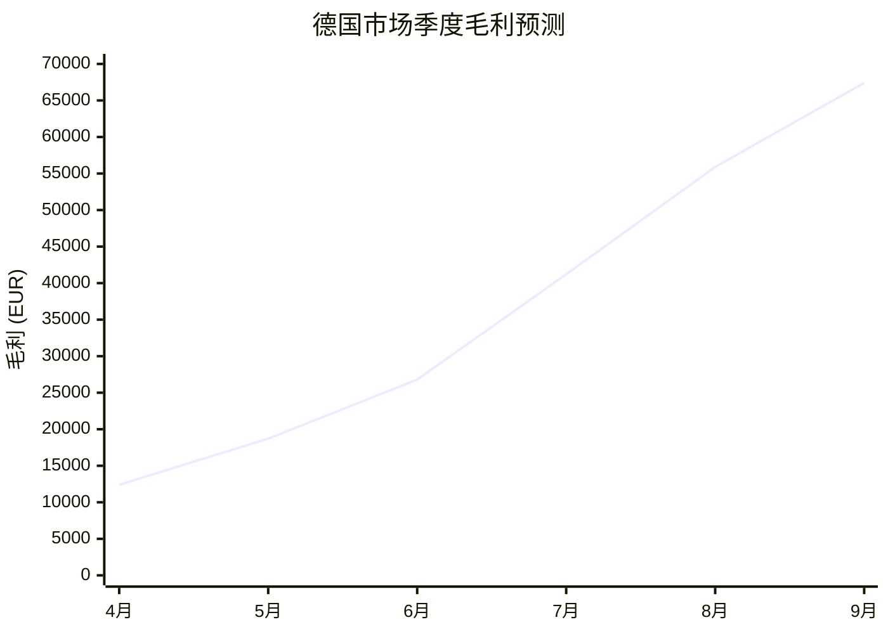

# 2026 春季欧洲市场拓展方案

> 本文档用于验证 Markdown Reader 的渲染能力，覆盖全部目标语法。
> 请重点检查：中文排版是否疏密得当、表格是否对齐、代码块是否可复制。

## 一、项目背景

我们计划在 2026 年 Q2 进入**德国**与**荷兰**两个市场，前期以 :rocket: 试水为主，
重点验证产品定位与渠道可行性。这段文字故意写得比较长，用来观察中文段落的
**行距、字距和两端对齐**是否舒适 —— 如果行与行之间挤在一起，说明优化层没生效。

德语区的采购决策链通常较长，据 :factory: 数据，客户平均需要 **6–8 周**完成评估，
因此 Q1 就要完成样品寄送与认证准备。

:::tip 小提示
认证周期是本方案最容易滑期的环节，建议提前 3 周联系第三方检测机构。
:::

## 二、目标市场对比

| 市场 | 准入门槛 | 客单价 (USD) | 竞争强度 | 推荐优先级 |
|:-----|:---------|-------------:|:--------:|:-----------:|
| 德国 | CE + EN71 认证 | 42,000 | 高 | **P0** |
| 荷兰 | CE 即可 | 31,500 | 中 | **P1** |
| 比利时 | CE 即可 | 28,800 | 低 | P2 |
| 西班牙 | CE + 当地语包装 | 35,200 | 中 | P2 |

> [!WARNING]
> 德国市场对包装上的 `:warning: 可降解` 标识有强制要求，漏标会导致海关扣留。

## 三、核心任务清单

### 3.1 认证准备
- [x] 整理现有 CE 证书扫描件
- [x] 联系 TÜV 报检
- [ ] 提交样品送检（预计 3 月 15 日前）
- [ ] 支付认证费用 €4,200

### 3.2 渠道拓展
1. 筛选德国本地经销商 10 家
   - 优先考虑有母婴渠道资源的
   - 避开与 XXX 直接竞争的 3 家
2. 发送样品与报价单
3. 安排线上会议

### 3.3 预算分配

```python
# 2026 Q2 德国市场预算（单位：欧元）
BUDGET = {
    "认证费用": 4200,
    "样品寄送": 1800,
    "展会摊位": 15000,
    "本地推广": 6000,
}

total = sum(BUDGET.values())
print(f"总计: EUR {total:,}")   # 总计: EUR 27,000
```

```bash
# 一键导出报价单
python export_quote.py \
  --market de \
  --currency EUR \
  --output quote_2026Q2.xlsx
```

## 四、销量预测模型

设每月订单量 $n$，单均毛利为 $m$，则季度毛利：

$$
G(n, m) = 3 \times n \times m \times (1 - \text{tax rate})
$$

其中 $m \approx 18.5$ EUR，当 $\text{tax rate} = 0.19$ 时：

$$
G(n) = 44.85 n
$$

下图为预测趋势：



## 五、风险与应对

:::caution 高风险
- **汇率**：欧元兑美元波动超过 5% 时需重新议价
- **物流**：旺季（11–12 月）海运需提前 6 周订舱
- **政策**：若欧盟提高 REACH 认证标准，检测成本将增加约 30%
:::

| 风险等级 | 概率 | 影响 | 应对预案 |
|:---:|:---:|:---:|:---|
| 高 | 中 | 严重 | 预留 €8,000 应急预算 |
| 中 | 高 | 中等 | 与客户约定汇率调整条款 |
| 低 | 低 | 轻微 | 无需预案 |

## 六、下一步

- [ ] 3 月 5 日前完成报价单初稿
- [ ] 3 月 10 日与法务确认合同模板
- [link] [查看本季度完整时间表](./timeline.md)

---

### 附：术语对照

德语区的 :memo: 采购经理在邮件中常用以下表述：

1. **`Angebot`** — 报价单（正式）
2. **`Preisliste`** — 价目表
3. **`Muster`** — 样品
4. **`Lieferzeit`** — 交货周期

需要注意，`Muster` 在德语中也可指「样本册」，首次接触时建议邮件中附英文对照[^1]。

[^1]: 2024 年德国 B2B 采购调研显示，供应商在首次邮件中主动提供中英/中德对照，可将回复率提升约 22%。

---

*文档结束 · 由 Markdown Reader 渲染*